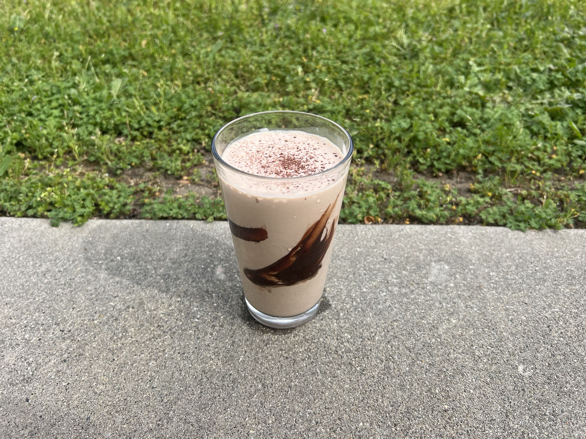

:::photos

:::

:::ingredients
- 1 cup vanilla greek yogurt
- 1 banana
- 1/8 cup cream / whole milk
- 1 tsp chocolate powder
:::

:::instructions
1. Put all ingredients into a blender and blend until smooth.
2. Enjoy!
:::

:::notes
### Yogurt Choice
- Greek yogurt is healthier and becomes less watery over time.
:::

::card
